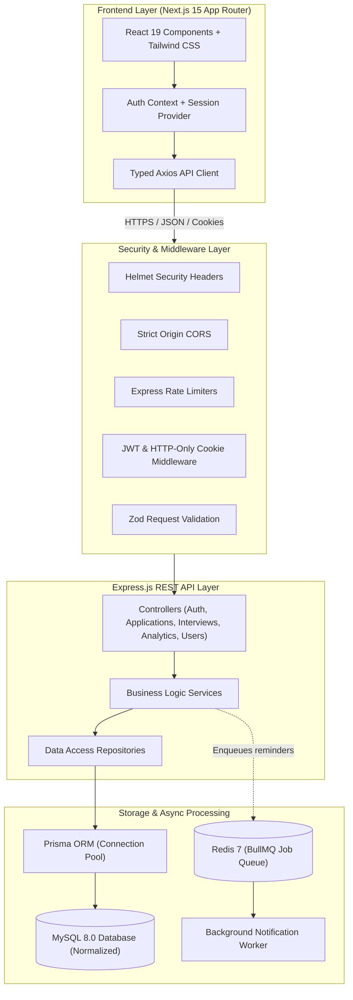
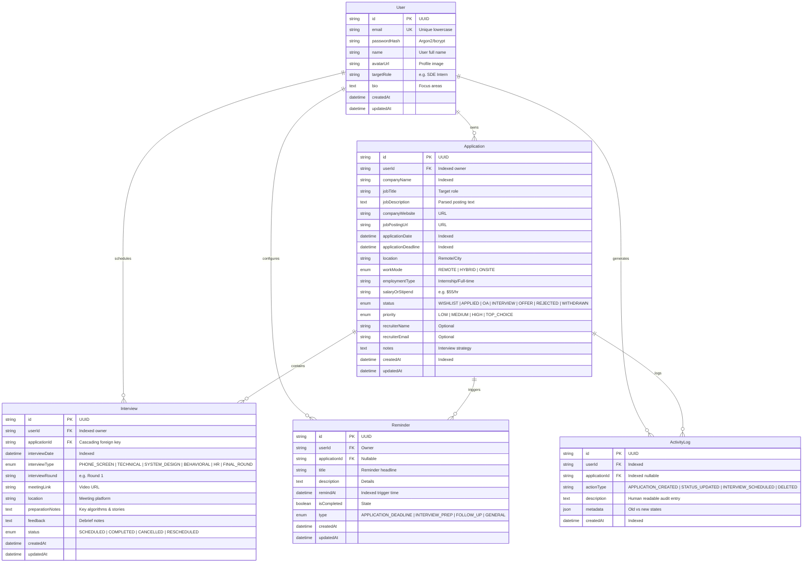
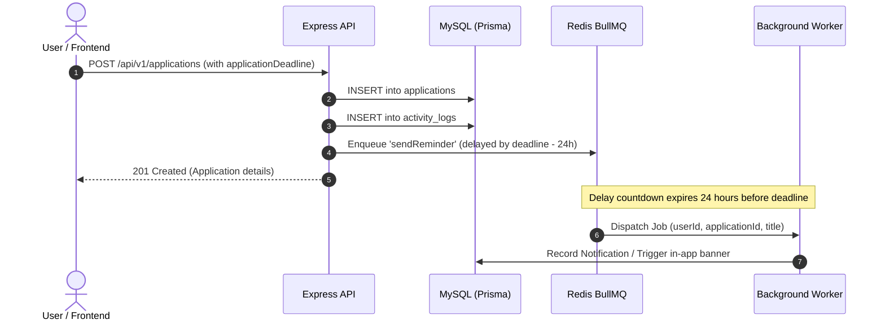

# ApplyTrack — System Architecture & Database Design

This document details the high-level architecture, relational database entity relationships, security isolation model, and data flow of **ApplyTrack**.

---

## 1. High-Level Architecture Diagram

---

## 2. Database Entity Relationship (ER) Diagram

---

## 3. Security & Multi-Tenant Data Isolation

1. **Server-Side Authorization**:
   - The user ID is **never** accepted from request bodies or URL parameters for access control.
   - The authenticated identity is extracted exclusively from the verified JWT payload (`req.user.id`).
2. **Compound Query Predicates**:
   - Every database query in the repository layer explicitly enforces `where: { id, userId }`.
   - Attempts to read, edit, or delete another user's records fail with a `404 Not Found` to prevent data leakage.
3. **Password Security**:
   - Passwords are salted and hashed using `bcrypt` (10 rounds). Plaintext passwords are never logged or stored.
4. **Cookie & Session Hygiene**:
   - The authentication token is sent with `httpOnly: true`, `sameSite: 'lax'`, and `secure: true` in production to mitigate XSS and CSRF vectors.
5. **Centralized Error Handling**:
   - Database internals and raw SQL errors are caught centrally and sanitized before sending responses to the client.

---

## 4. Background Job & Queue Architecture

